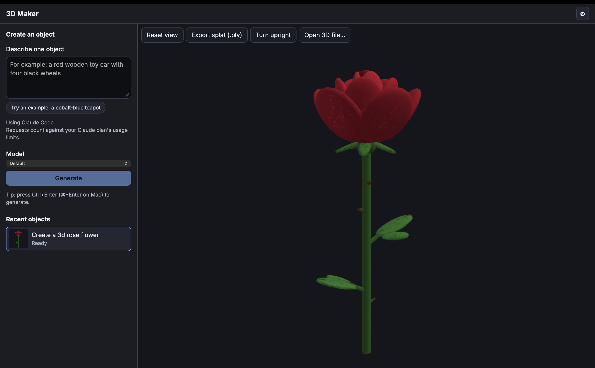

# 3D Maker

**Type what you want. Get a 3D object.**

Write a sentence like *"a yellow toy forklift with black wheels"* and 3D Maker builds a 3D model you
can spin around, zoom into and save. You can also open your own 3D files and change them with words,
like *"make the wheels red"*.

Free and open source. Works on **Mac, Windows and Linux**.



---

## 1. Download

👉 **[Download the latest version](https://github.com/AminMemariani/3DMaker/releases/latest)**

On that page, scroll down to **Assets** and click the file for your computer:

| Your computer | File to download |
|---|---|
| 🍎 **Mac** (any Mac from 2015 or newer) | the file ending in **`.dmg`** |
| 🪟 **Windows** 10 or 11 | the file ending in **`-setup.exe`** |
| 🐧 **Linux** | the file ending in **`.AppImage`** (or **`.deb`** for Ubuntu/Debian) |

---

## 2. Install

### 🍎 Mac

1. Double-click the **`.dmg`** file you downloaded.
2. In the window that opens, **drag the 3D Maker icon onto the Applications folder**.
3. Open your **Applications** folder and double-click **3D Maker**.
4. The first time, your Mac says it **can't verify** the app. This is normal for free apps that
   aren't sold through Apple. Click **Done** (not "Move to Trash"), then:
   - Open **System Settings** → **Privacy & Security**.
   - Scroll down and click **Open Anyway** next to 3D Maker, then enter your password.
   - From now on it opens normally.

<details>
<summary>Still won't open, or says the app is "damaged"?</summary>

Open the **Terminal** app (search for it with ⌘ + Space), paste this line and press Enter:

```
xattr -cr "/Applications/3D Maker.app"
```

Then open 3D Maker again.
</details>

### 🪟 Windows

1. Double-click the **`-setup.exe`** file you downloaded.
2. If a blue box says **"Windows protected your PC"**, click **More info** → **Run anyway**.
   (This appears for free apps without a paid certificate.)
3. Follow the installer. 3D Maker then appears in your **Start menu**.

### 🐧 Linux

- **AppImage:** right-click the file → **Properties** → **Permissions** → tick
  **Allow executing file as program**. Then double-click it.
- **.deb (Ubuntu/Debian):** double-click it to install with your Software app, or run
  `sudo apt install ./3D*.deb` in a terminal.

---

## 3. Connect an AI (one time)

3D Maker uses an AI to design your object. When the app opens, it shows **Choose your AI**. Pick
**one** of these:

| Option | Cost | What to do |
|---|---|---|
| **Claude Code** or **Codex** | Included in your Claude or ChatGPT subscription | If you already use one, 3D Maker finds it automatically and shows **Found**. Just click **Use**. |
| **Ollama** | Free, works offline | Install [Ollama](https://ollama.com), open it, and in a terminal run `ollama pull llama3.2`. Back in 3D Maker click **Look again**, then **Use Ollama**. |
| **Anthropic** or **OpenAI** | Pay per use (usually a few cents per object) | Click **Get a key**, create an account, copy the key, paste it into 3D Maker and click **Connect**. |

Your key stays on your computer, stored in your system's secure password storage.

---

## 4. Make your first object

1. Type a description, for example:
   *A cobalt-blue ceramic teapot with one curved spout, a round brass lid, and a large loop handle.*
2. Click **Generate** and wait about 20–60 seconds.
3. **Drag** to spin it, **scroll** to zoom.
4. Click **Export** to save it as a `.ply` file you can use in other 3D apps.

**More things to try**

- **Change an object with words:** type something like *"make the lid gold"* in
  **Adjust with a prompt** under the 3D view. You get a new copy; the original is kept.
- **Open your own 3D files:** click **Open 3D file…** and choose a `.ply`, `.obj` or `.stl` file.
- Everything you make is saved under **Recent objects** and opens again anytime, even offline.

---

## Need help?

- **"Couldn't reach …"**: check your internet connection and try again. If it keeps happening,
  copy the whole message (including the **Details:** line) into a
  [new issue](https://github.com/AminMemariani/3DMaker/issues).
- **"rejected your key"**: the key was mistyped or has expired. Paste a fresh one in **Settings** (⚙).
- **Claude Code / Codex "isn't signed in"**: open a terminal and run `claude` or `codex login`
  once, then try again.
- Found a bug or have an idea? [Open an issue](https://github.com/AminMemariani/3DMaker/issues).

## For developers

Build instructions, architecture and tests are in **[docs/DEVELOPING.md](docs/DEVELOPING.md)**.
Contributions are welcome. 3D Maker is released under the [MIT License](LICENSE).

---

## ❤️ Support this project

3D Maker is free. If it's useful to you, you can support its development with a donation in
**Solana (SOL)**:

```
ApeGNaqfRM3HJocYHfdZ88GmFj2wqVCxUzm5MGvGNrWy
```

Thank you!
